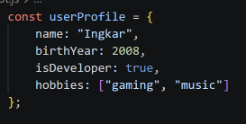
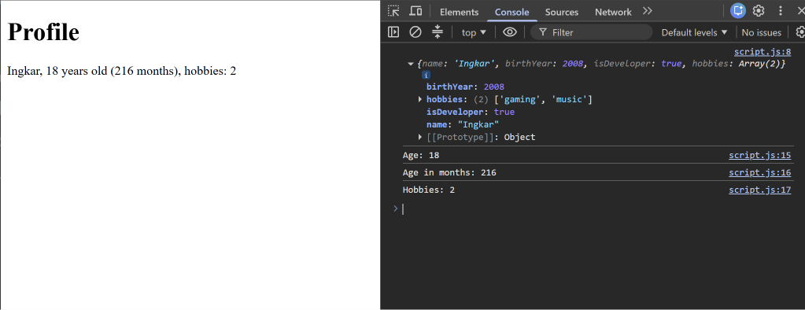
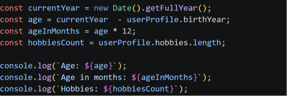
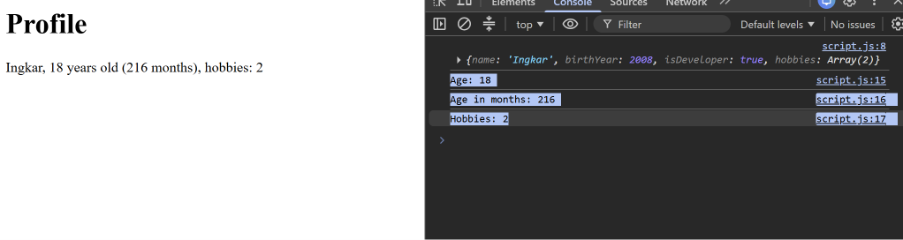
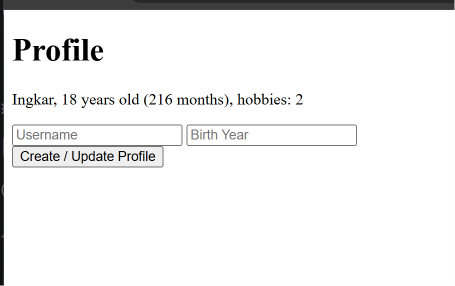
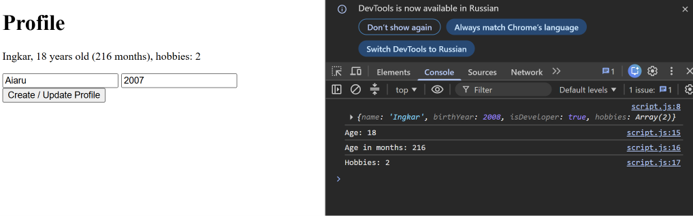
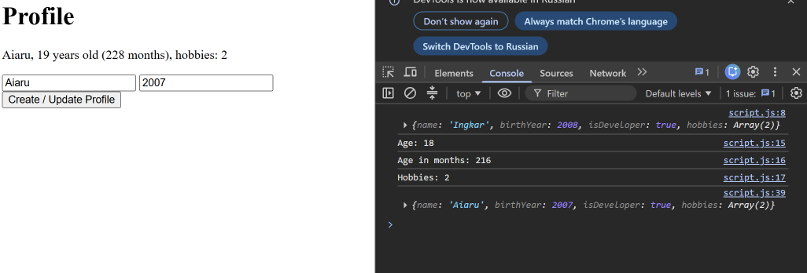
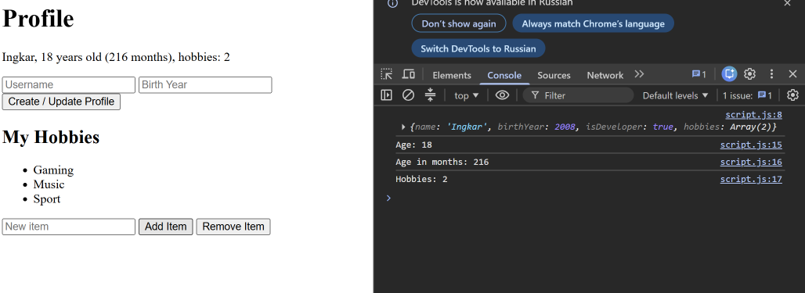
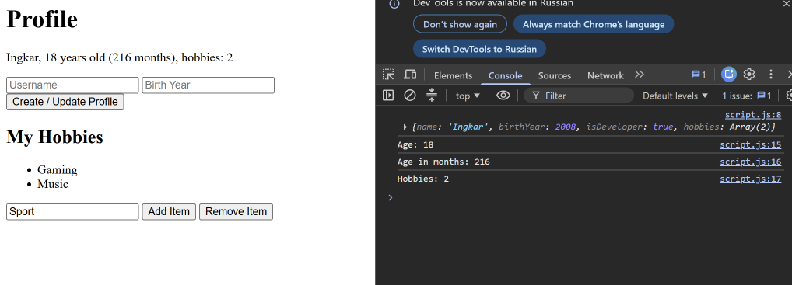

# Assignment 5. JavaScript Basics (DOM Manipulation & Events)

**Name:** Ingkar Tolegen
**Group:** SE-2540

**GitHub Pages:** https://github.com/InkarTolegen2/Assignment5_WEB1.git
**URL:** https://inkartolegen2.github.io/Assignment5_WEB1/

---

## Part 1: Profile Object, Data Types & Arithmetic

### Task 1. The Personal Info Object
Create a JavaScript const object named `userProfile` that stores a string (name), a number (birthYear), a boolean (isDeveloper) and an array (hobbies).

### Task 2. Arithmetic Calculations
Calculate the user's current age dynamically and one more metric (age in months, hobbies count). Display the values in the console and on the page.

---

## Part 2: Form Input & Event Responses

### Task 3. HTML Form Setup
Create a form with an input for Username, an input for Birth Year and a "Create / Update Profile" button.

### Task 4. Event Listener
Add a click event listener to the button. When it is clicked, take the input values and update the `userProfile` object.

---

## Part 3: DOM List Manipulation

### Task 5. Creating & Removing Elements
Create a `<ul>` list. The "Add Item" button adds a new `<li>` from the input. The "Remove Item" button deletes the last item.

---

## Summary of my work process
[2-4 предложения своими словами]